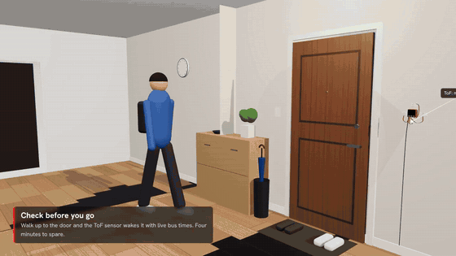
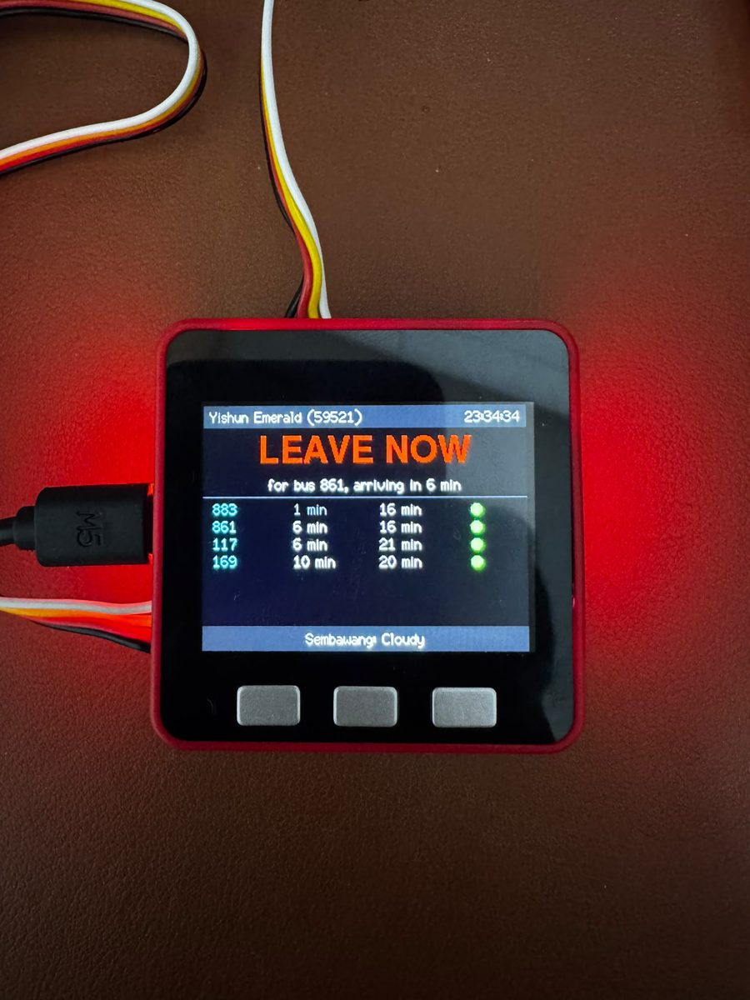
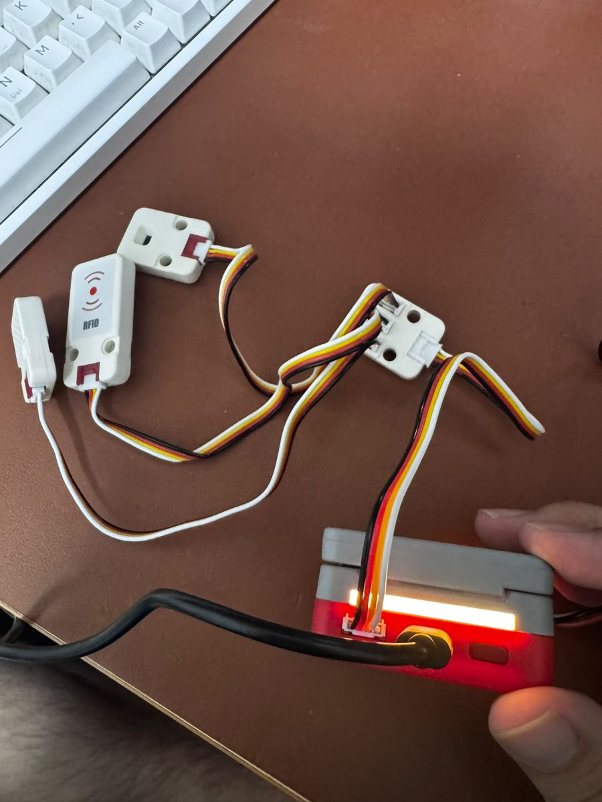

# ExitPilot: an M5Stack Fire that tells you when to leave the house

A box by the front door that answers one question every morning: **when do I need to walk out to catch my bus?**

It pulls live bus arrivals for your stop from LTA DataMall, subtracts your walking time, and shows a big **"Leave in 4 min" / "LEAVE NOW"**. If NEA's 2-hour forecast says rain for your area, the screen bar turns blue, the side LEDs pulse blue and it beeps: bring an umbrella.

  

<b><a href="docs/exitpilot-demo.mp4">Watch the full 56-second 3D walkthrough (MP4)</a></b>: checking it before you leave, the rain warning, tapping out, sleep, night dimming and coming home. The interactive version with chapters is <code>docs/animation/index.html</code> (open it in a browser).

  
  

## What it does

| Feature | Source |
|---|---|
| Live arrivals (next 2 buses per service) for one bus stop | LTA DataMall BusArrival v3 |
| "Leave in X min" countdown using your walk time | computed on the Fire |
| Crowd level of the next bus (green seats / yellow standing / red packed) | LTA `Load` field |
| Rain warning: blue bar, blue breathing LEDs, beep | data.gov.sg NEA 2-hour forecast |
| LED bars: green = relax, amber = get ready, red = leave now | Fire side LED bars |
| Wakes when someone walks up, sleeps 60 s after (and checks buses less often while asleep) | ToF unit, self-learning background distance |
| Dims the screen and LEDs in a dark corridor | Light unit |
| Indoor temperature and humidity in the bottom bar | ENV II unit (SHT30) |
| Beeps twice as you walk up if rain is forecast | ToF + NEA forecast |
| Tap a card on the way out / in: "Jad left home at 07:42, heading for bus 169" / "Jad is home at 18:05" on Telegram | RFID unit + Telegram bot |

All internet work (LTA, NEA, Telegram) runs in a background task on the ESP32's second core, so the screen, sensors and RFID reader never wait on the network.

## Why it matters

### Saves power and shared data, not just time

ExitPilot is built to sit by the door 24/7, so it shouldn't burn power showing bus times to an empty corridor.

- **Screen and LEDs only run when someone is there.** The ToF sensor turns everything on when you walk up and off again 60 s after you leave (`AWAKE_SECONDS`). If 20 people pass the door in a day, the screen is on for about 20 minutes instead of 24 hours: roughly **98% less screen-on time** than an always-on display.
- **Night dimming.** In a dark corridor the backlight drops from 180 to 25 (about 86% lower) and the LED bars to a faint glow, so it isn't lighting up the house at 2 am.
- **Fewer API calls.** While nobody is around it checks LTA every 2 minutes instead of every 30 seconds, and fetches fresh times the moment someone walks up. That's up to **75% fewer requests** to LTA DataMall, a free service shared by every developer in Singapore.
- **Reuse.** The RFID "key" can be an old expired contactless bank card, so nothing new has to be bought for it.

### RFID check-in/out: who it's for

Each tap sends one Telegram message with the time (and, when leaving, the bus being caught). There's no GPS and no phone tracking; it only records a tap at the door that the person chose to make.

| Use case | How ExitPilot helps |
|---|---|
| **Parents and children** | A child taps their card when leaving for school and when getting home. Parents at work get "left home at 07:12, heading for bus 169" and "home at 15:40" without the child having to remember to text. |
| **Elderly family members living alone** | A tap when going out and coming back gives family a simple sign of their day and routine, without cameras or wearables. |
| **Shared flats and hostels** | A "who's home" log in a group chat, so housemates know whether to lock up or expect someone. |
| **Small offices, labs and makerspaces** | Replaces a paper sign-in sheet: every tap in or out goes to a Telegram group with the time. During a fire drill, the log shows who is still inside. |
| **Shared equipment** | Put a tag on a camera, tool or laptop and tap it out and back in to see who has it. |

Today the firmware handles one person and one card (`PERSON_NAME`, `KNOWN_TAGS`). Supporting several people would mean mapping each tag to a name, which is a small change to `handleTap()`.

**Privacy:** the reader only reads the card's chip ID, never a bank card number, and messages go only to the Telegram chat the owner set up. Anyone using it to keep track of someone else should make sure that person knows and agrees.

## Hardware

- M5Stack Fire
- Port A (I2C) → HUB unit → RFID unit (0x28), ToF unit (0x29), ENV II unit (0x44 / 0x76)
- Any RFID card or tag (an old contactless debit card works)
- Port B → Light unit (analog on GPIO36)

  
  
  

## Setup

1. Install VS Code + the PlatformIO extension and open this folder.
2. Get a free LTA DataMall API key at <https://datamall.lta.gov.sg> (Request for API Access). Use the **API Account Key** from the "Registration Confirmation" email, not the SDK key.
3. Copy `include/secrets.example.h` to `include/secrets.h` and fill in your 2.4 GHz Wi-Fi name, password and the API key. `secrets.h` is git-ignored.
4. Edit `include/config.h`: bus stop code, stop name, walking minutes, NEA area name, optional list of your buses.
5. Optional, for RFID check-in/out messages: in Telegram, message **@BotFather**, send `/newbot` and put the token in `TELEGRAM_BOT_TOKEN`. Then send your new bot any message. The Fire reads that first message to find your chat and remembers it (you can also set `TELEGRAM_CHAT_ID` yourself).
6. Click **Upload** in PlatformIO, then open the Serial Monitor (115200) to see every API call.

## RFID notes

- Any ISO 14443A card works: MIFARE tags, many student cards, and most contactless bank cards. Only the chip's ID is read, never a card number.
- Some bank cards make up a new random ID on every tap (the ID starts with `08`); the Fire tells you to use another tag.
- To allow only your own tags, tap them once, read the ID from the screen or serial log, and list them in `KNOWN_TAGS`.
- A tap counts when the card arrives. It must leave the reader for 1.5 s and there's a 5 s lockout, so one tap can't log "left" and "home" together.

## Buttons

- **A**: refresh now
- **B**: mute / unmute
- **C**: toggle between all buses and `MY_BUSES`

## Build log

- **Step 1**: wiring check: I2C scan for RFID, ToF and ENV II plus a Light unit reading, all found.
- **Step 2**: Wi-Fi, NTP time (SGT), live LTA bus arrivals and the leave-now countdown.
- **Step 3**: NEA 2-hour forecast and rain alert.
- **Step 4**: ToF wake/sleep with a learned background (works wherever it's mounted), Light-unit night dimming (this unit reads higher when darker: ~2150 lit, 4095 dark), ENV II indoor readout, automatic Wi-Fi reconnect.
- **Step 5**: RFID tap-in/out (locked to the owner's card with `KNOWN_TAGS`) with Telegram messages (chat found automatically, state kept across reboots). Network moved to its own task on core 0 so taps register instantly; tap debouncing by card presence plus a lockout.
