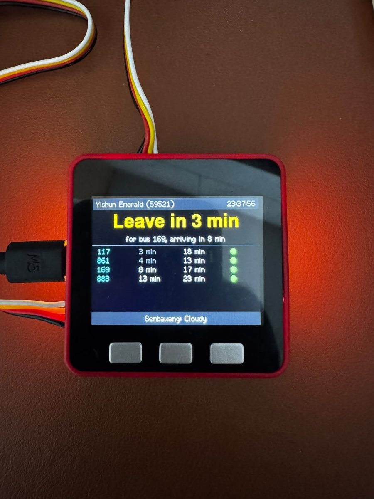
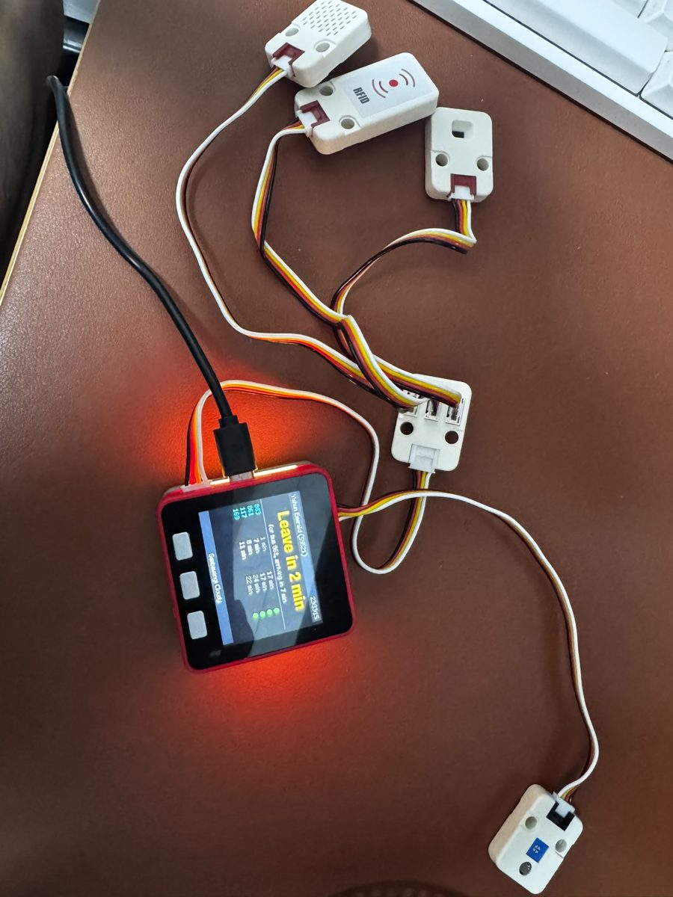
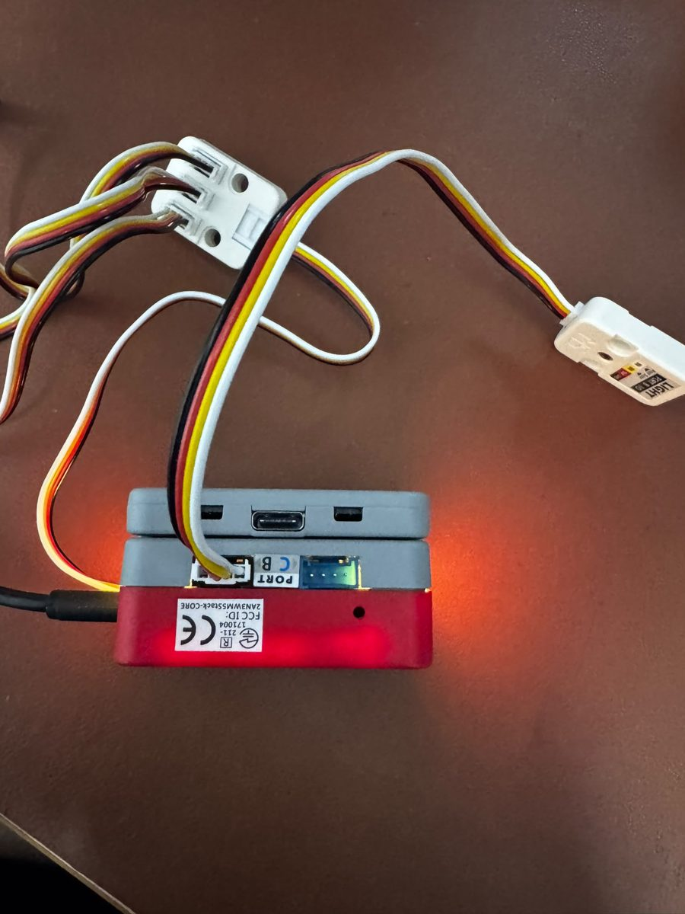

# ExitPilot: an M5Stack Fire that tells you when to leave the house

A box by the front door that answers one question every morning: **when do I need to walk out to catch my bus?**

It pulls live bus arrivals for your stop from LTA DataMall, subtracts your walking time, and shows a big **"Leave in 4 min" / "LEAVE NOW"**. If NEA's 2-hour forecast says rain for your area, the screen bar turns blue, the side LEDs pulse blue and it beeps: bring an umbrella.

  
  

## What it does

| Feature | Source |
|---|---|
| Live arrivals (next 2 buses per service) for one bus stop | LTA DataMall BusArrival v3 |
| "Leave in X min" countdown using your walk time | computed on the Fire |
| Crowd level of the next bus (green seats / yellow standing / red packed) | LTA `Load` field |
| Rain warning: blue bar, blue breathing LEDs, beep | data.gov.sg NEA 2-hour forecast |
| LED bars: green = relax, amber = get ready, red = leave now | Fire side LED bars |

Coming next: ToF wake-on-approach, Light-unit auto dimming, ENV II indoor temperature/humidity, and RFID tap-out that sends a Telegram message.

## Hardware

- M5Stack Fire
- Port A (I2C) → HUB unit → RFID unit (0x28), ToF unit (0x29), ENV II unit (0x44 / 0x76)
- Port B → Light unit (analog on GPIO36)

  
  
  

## Setup

1. Install VS Code + the PlatformIO extension and open this folder.
2. Get a free LTA DataMall API key at <https://datamall.lta.gov.sg> (Request for API Access). Use the **API Account Key** from the "Registration Confirmation" email, not the SDK key.
3. Copy `include/secrets.example.h` to `include/secrets.h` and fill in your 2.4 GHz Wi-Fi name, password and the API key. `secrets.h` is git-ignored.
4. Edit `include/config.h`: bus stop code, stop name, walking minutes, NEA area name, optional list of your buses.
5. Click **Upload** in PlatformIO, then open the Serial Monitor (115200) to see every API call.

## Buttons

- **A**: refresh now
- **B**: mute / unmute
- **C**: toggle between all buses and `MY_BUSES`

## Build log

- **Step 1**: wiring check: I2C scan for RFID, ToF and ENV II plus a Light unit reading, all found.
- **Step 2**: Wi-Fi, NTP time (SGT), live LTA bus arrivals and the leave-now countdown.
- **Step 3**: NEA 2-hour forecast and rain alert.
